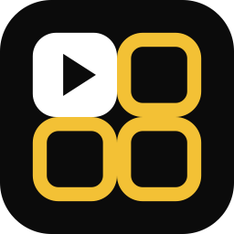

<h1 align="center">FullPlay</h1>

<b>Sinalética e reprodução de conteúdos para Android TV</b> Uma solução Eventuais

---

A FullPlay transforma uma TV Android, uma Google TV ou uma box Android ligada por HDMI num leitor de sinalética. Reproduz vídeos e imagens em playlist, em ecrã inteiro ou num layout com relógio, data, meteorologia, notícias RSS e logótipo do cliente. Controla-se pelo comando, pelo telemóvel (Mobile Control), por um backoffice no browser e por OSC. Funciona em rede local; a Internet só é precisa para a meteorologia, as notícias e as atualizações.

## Versão atual

| Aplicação | Para quê | Versão | Descarregar |
|---|---|---|---|
| **FullPlay** | Leitor de sinalética para Android TV / Google TV | **0.2.0** | [FullPlay-0.2.0.apk](https://github.com/eventuais-software/fullplay/releases/download/fullplay-0.2.0/FullPlay-0.2.0.apk) |

Todas as versões, com as notas de cada uma, estão em [Releases](https://github.com/eventuais-software/fullplay/releases). O que mudou em cada versão está no [Histórico de versões](HISTORICO.md).

## O que faz

- **Reprodução:** playlists de vídeos e imagens, loop, slideshow com transições; ficheiros da própria TV, de uma PEN USB ou endereços de rede (HTTP, HLS, RTSP).
- **Full screen** (por omissão) ou **layout** com relógio, data, meteorologia, RSS, logótipo, texto e QR; imagem de fundo do cliente.
- **Agenda:** horário de funcionamento e blocos por dia da semana ou por data.
- **Rotação** do ecrã (TVs na vertical) e **mira de testes**.
- **Controlo:** comando da TV, Mobile Control e backoffice no browser (com PIN), OSC (UDP 9000).
- **Licença** emitida pela Eventuais; sem licença funciona em modo demonstração (marca de água).
- **Atualizações** a partir desta página, com confirmação na TV.

## Guias

- [FullPlay na TV: instalar, usar, licença e atualizações](docs/guia-tv.md)

## Requisitos

Android 7.0 ou mais recente (Android TV, Google TV ou box Android), com o "Android System WebView" atualizado. Para comandar pelo telemóvel ou computador, estes têm de estar na mesma rede da TV.

---

© Eventuais · Events & Communication
